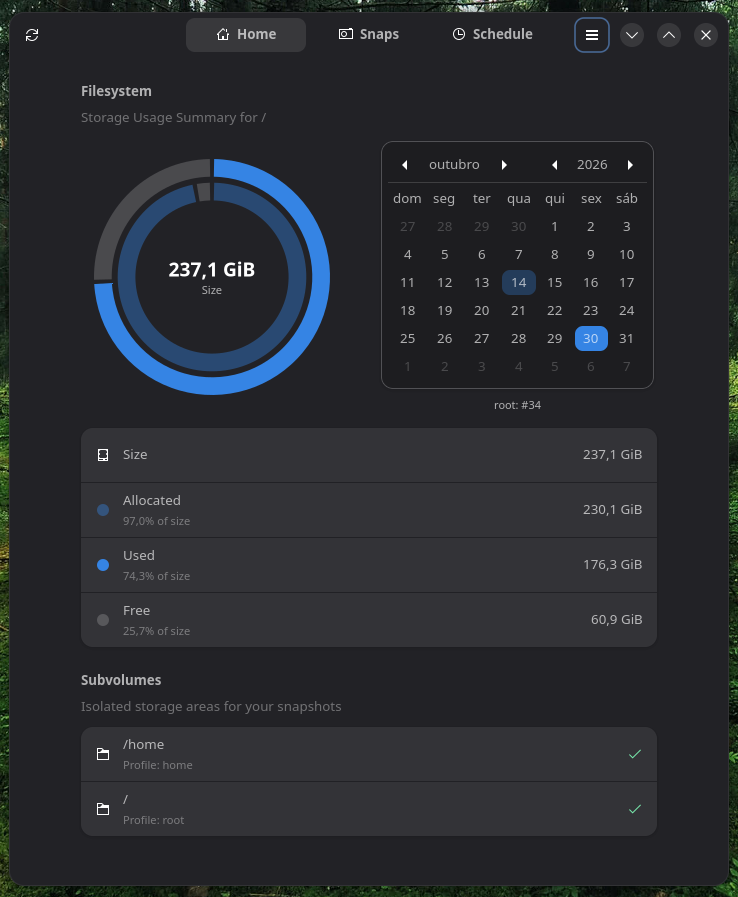
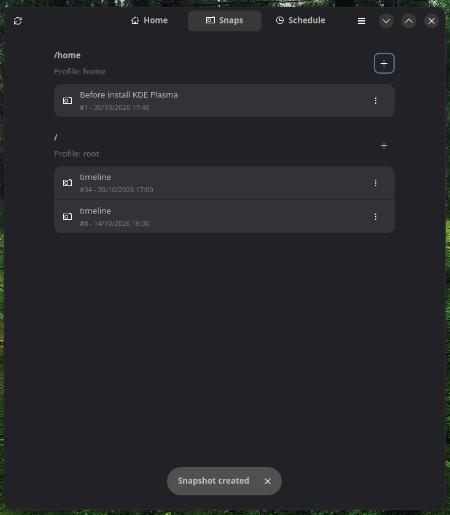
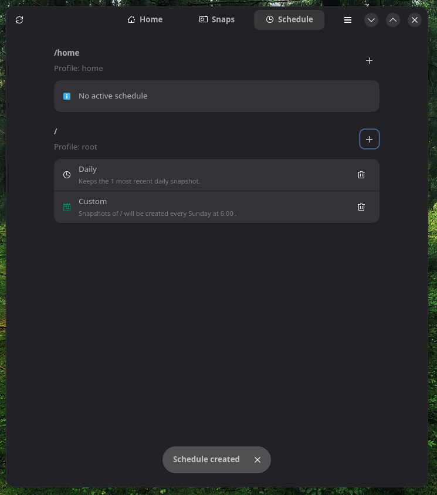

# Scatto

A native GTK 4 / libadwaita front end for [Snapper](http://snapper.io/), the Btrfs snapshot manager.
Browse, create, restore and delete snapshots, see how your disk is being used, and schedule automatic
snapshots, all without touching the command line.

Scatto follows the GNOME Human Interface Guidelines and uses the stock Adwaita theme: it picks up your
accent color, dark mode and fonts, and ships no custom stylesheet beyond a few small tweaks for the
calendar.

## Screenshots







## Features

- **Home**
  - Concentric ring chart of the filesystem: the outer ring shows used and free space, the inner ring
    shows allocated and unallocated space. Hover a slice to highlight it and see its size and share.
  - Snapshot calendar: days that have at least one snapshot in any Snapper profile are marked with a red
    dot. Select a day to see which profiles have snapshots on it.
  - List of the Snapper profiles with a health check for their `.snapshots` directory.
- **Snaps**
  - One group per Snapper profile, with every snapshot listed by description, number, date and type
    (single, pre, post or timeline). The default snapshot is marked.
  - Create a snapshot with an optional description.
  - Browse a snapshot in your file manager.
  - Restore or delete a snapshot, both behind a confirmation dialog.
- **Schedule**
  - Hourly, daily, weekly, monthly and yearly retention, using Snapper's own timeline.
  - Custom schedules for any combination of weekdays and a time of day.
  - Every rule can be removed with one click.
- **Everything else**
  - Runs unprivileged and asks for administrator rights once, at startup (see [How privileges work](#how-privileges-work)).
  - Available in 11 languages (see [Translations](#translations)).
  - Refresh with the toolbar button, `Ctrl+R` or `F5`.

## Requirements

### Runtime

| Dependency | Why it is needed |
| --- | --- |
| Snapper | Does all the snapshot work. Scatto calls `/usr/bin/snapper`. |
| polkit (`pkexec`) | Starts the privileged helper. |
| A Btrfs filesystem with at least one Snapper profile | The usage chart reads Btrfs allocation data from `/sys/fs/btrfs`. Other filesystems show the basic numbers only. |
| `findmnt` (util-linux) | Finds the Btrfs filesystem UUID. |
| systemd user instance | Runs the custom schedules. |
| `snapper-timeline.timer` enabled | Needed for the hourly to yearly schedules to take effect. |

If you have no Snapper profile yet, create one first:

```sh
sudo snapper -c root create-config /
```

### Build

- A C++17 compiler
- Meson and Ninja
- pkg-config
- GTK 4.12 or newer
- libadwaita 1.5 or newer
- GLib and GIO (including `gio-unix`)
- gettext (for the translations)

Packages for common distributions:

```sh
# Fedora
sudo dnf install gcc-c++ meson ninja-build pkgconf-pkg-config gettext gtk4-devel libadwaita-devel

# Debian / Ubuntu (24.04 or newer, for libadwaita 1.5)
sudo apt install g++ meson ninja-build pkg-config gettext libgtk-4-dev libadwaita-1-dev

# Arch Linux
sudo pacman -S gcc meson ninja pkgconf gettext gtk4 libadwaita
```

## Building and installing

```sh
git clone https://github.com/FlaipyTheHost/scatto.git
cd scatto
meson setup build --prefix=/usr
meson compile -C build
sudo meson install -C build
```

This installs the `snapper-manager` and `snapper-manager-helper` executables, the desktop entry, the
icon and the translations. The two executables must stay in the same directory, because the app looks
for the helper next to itself.

### Running from the build directory

You can try the app without installing it:

```sh
./build/snapper-manager
```

Run it as your normal user, not with `sudo`. Scatto asks for administrator rights on its own, and
running the whole interface as root loses your theme, icons and language.

Translations are picked up from `build/po` automatically. To use a different location, set
`SCATTO_LOCALEDIR`.

## How privileges work

Managing Snapper requires root, but a graphical interface should not run as root. Scatto splits the
work in two:

- `snapper-manager` is the interface. It runs as your user and keeps your theme, fonts and settings.
- `snapper-manager-helper` is a small process with no interface. It is started once through `pkexec`
  when the app opens, which is when you see the authentication prompt, and it stays alive for the
  whole session.

The two talk over a simple pipe. For each request, the helper runs `/usr/bin/snapper` with the
arguments the interface sends, and sends back the exit status, standard output and standard error. It
runs that program and nothing else: it never starts a shell and never runs any other executable.

If authentication is cancelled or fails, or if `pkexec` is missing, the app shows a dialog explaining
why and quits.

Custom schedules are the one thing that does not go through the helper. They are `systemd --user`
timers that run as you, so the user has to be allowed to run `snapper create` for that profile. See
[Snapshot access](#snapshot-access) below for the related permission.

## How scheduling works

Snapper has two different ideas of "schedule", and Scatto exposes both.

**Hourly, Daily, Weekly, Monthly and Yearly** edit Snapper's real configuration:

```sh
snapper -c <profile> set-config TIMELINE_CREATE=yes TIMELINE_LIMIT_<PERIOD>=<count>
```

Each value is a retention count, for example "keep the 7 most recent daily snapshots". Snapper's
timeline takes one snapshot per hour and then cleans up according to these limits, so it only does
anything when the timer is enabled:

```sh
sudo systemctl enable --now snapper-timeline.timer
```

**Custom** covers what Snapper cannot do by itself, such as "every Tuesday and Thursday at 03:00". Scatto
writes a `.timer` and a `.service` pair into `~/.config/systemd/user/` that runs
`snapper -c <profile> create` at the chosen times, and enables it.

## Snapshot access

Snapper creates `<subvolume>/.snapshots` readable by root only, so a normal user cannot open a snapshot
in a file manager. The first time you choose **Browse Files** and cannot read the folder, Scatto offers
to fix it. If you agree, it adds your user to `ALLOW_USERS` and turns on `SYNC_ACL` in that profile's
Snapper configuration, keeping any users that were already allowed. Nothing is changed unless you
confirm.

## Snapper commands used

| Action | Command |
| --- | --- |
| List profiles | `snapper --csvout list-configs` |
| List snapshots | `snapper -c <profile> --csvout --iso list --columns number,date,description,type,active` |
| Create | `snapper -c <profile> create --type single --description "..."` |
| Restore | `snapper -c <profile> undochange <N>..0` |
| Delete | `snapper -c <profile> delete <N>` |
| Read settings | `snapper -c <profile> --csvout get-config --columns key,value` |
| Change settings | `snapper -c <profile> set-config <KEY>=<value> ...` |

Restore uses `undochange`, which reverts the file changes made since snapshot `N`. It is not a full
rollback of the subvolume, and it cannot be undone.

## Translations

Scatto uses gettext, the standard for GTK applications. The source language is English, and these
translations are included:

Arabic, Bengali, Chinese (Simplified), French, Hindi, Portuguese (Brazil), Portuguese (Portugal),
Russian, Spanish and Urdu.

The translations have not been reviewed by native speakers. Corrections are very welcome.

To try a language:

```sh
LANGUAGE=es ./build/snapper-manager
```

If the app stays in English, also set a locale that exists on your system, for example
`LANG=es_ES.UTF-8 LANGUAGE=es`. Run `locale -a` to see which ones you have.

### Working on translations

Files live in `po/`: `scatto.pot` is the template, and there is one `.po` file per language.

```sh
meson compile -C build scatto-pot          # regenerate the template from the source
meson compile -C build scatto-update-po    # merge the template into every .po file
```

To add a language, create `po/<code>.po` (for example with `msginit`) and add its code to
`po/LINGUAS`. When you add or change user-visible text in the code, wrap it in `_()` (or `ngettext()`
for plurals) and make sure the file is listed in `po/POTFILES.in`.

## Project layout

| Path | Purpose |
| --- | --- |
| `main.cpp` | Application, main window, header bar, primary menu and About dialog |
| `home_page.*` | Home tab: usage chart, snapshot calendar, profile list |
| `snaps_page.*` | Snaps tab: create, browse, restore and delete snapshots |
| `schedule_page.*`, `schedule_dialog.*` | Schedule tab and the "New schedule" dialog |
| `timeline_periods.hpp` | Snapper's timeline periods and their retention sentences |
| `systemd_timer.*` | Creation, listing and removal of custom `systemd --user` timers |
| `ring_chart.*` | The ring chart, drawn with Cairo using theme colors |
| `fs_info.*` | Filesystem size and usage, including Btrfs allocation data |
| `snapper_cli.*` | Running Snapper asynchronously and parsing its CSV output |
| `root_helper.*`, `ipc_protocol.*` | Starting the privileged helper and talking to it |
| `helper/helper_main.cpp` | The root helper, which only runs `/usr/bin/snapper` |
| `i18n.hpp` | Translation macros and `format_string()` |
| `po/` | Translation template and catalogs |
| `data/` | Desktop entry template and application icon |

## Limitations

- The usage chart always reads the filesystem mounted at `/`.
- The allocated and unallocated figures only exist on Btrfs. On other filesystems the chart falls back
  to the basic numbers.
- The description of a custom schedule is stored in the language the app was using when the schedule
  was created.

## Contributing

Bug reports and pull requests are welcome on the
[issue tracker](https://github.com/FlaipyTheHost/scatto/issues). When reporting a problem, please include
your distribution, the GTK and libadwaita versions, and the output of `snapper --version`.

## License

Scatto is released under the GNU General Public License, version 3 or later. See [LICENSE](LICENSE) for
the full text.
